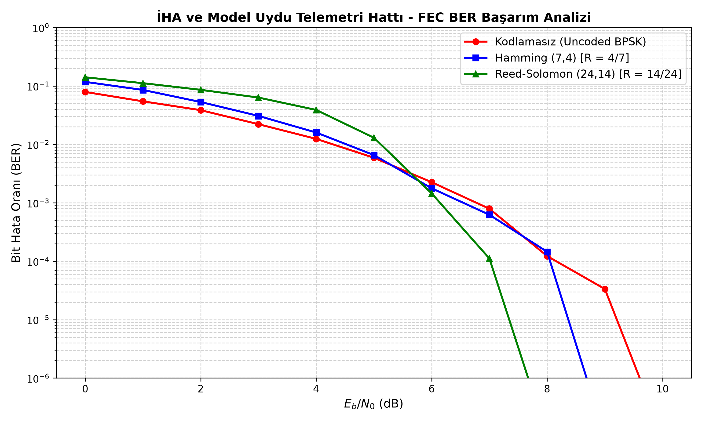

# İHA ve Model Uydu Telemetri Sinyallerinde FEC Sistemi

Bu proje, kablosuz haberleşme hatlarında gürültü ve kanal bozulmaları nedeniyle oluşan veri kayıplarını ve bit hatalarını en aza indirmek amacıyla geliştirilmiş bir **Forward Error Correction (FEC - İleri Hata Düzeltme)** simülasyon ve uygulama projesidir.

## Projenin Amacı ve Kapsamı

Model uydular ve İHA'lar uçuş sırasında yer istasyonuna anlık telemetri verileri (irtifa, basınç, pil voltajı vb.) gönderirler. Ancak RF ortamındaki gürültüler, çok yollu yayılım ve sinyal zayıflamaları paket kayıplarına yol açabilir.

Bu projede:
* Gerçekçi bir **İkili Simetrik Kanal (BSC)** ve **BPSK modülasyonlu AWGN** gürültü modeli simüle edilmiştir.
* Hata tespiti ve düzeltmesi için matris tabanlı **Hamming(7,4)** kodları ve blok/burst hatalarına karşı **Reed-Solomon(24,14)** algoritmaları entegre edilmiştir.
* Sensör verileri `struct` yapısı ile gerçek bir mikrodenetleyici paket formatında (Little-Endian, 14 Byte / 112 Bit) serileştirilmiştir.
* FEC kullanan ve kullanmayan sistemlerin **Bit Hata Oranı (BER)** performans kıyaslamaları Monte Carlo simülasyonu ile grafiksel olarak raporlanmıştır.

---

## Sistem Mimarisi ve Akış

```text
[ Veri Kaynağı (Sensörler - 14 Byte) ]
       │
       ▼
[ Kanal Kodlayıcı (FEC Encoder) ] ──> Hamming(7,4) / Reed-Solomon(24,14)
       │
       ▼
[ RF Kanal / Gürültü Simülasyonu ] ──> BPSK + AWGN / BSC (Bit Flip)
       │
       ▼
[ Kanal Kod Çözücü (FEC Decoder) ] ──> Sendrom Hesabı ve Hata Düzeltme
       │
       ▼
[ Alıcı / Yer İstasyonu (Clean Payload) ]
```

---

## Başarım Analizi ve Simülasyon Sonuçları



Simülasyon sonuçlarından elde edilen temel mühendislik bulguları:
* **Kodlama Eşiği (Coding Threshold - ~5.5 dB):** Çok düşük SNR ($0 - 5\text{ dB}$) bölgelerinde, FEC algoritmalarının eklediği eşlik (parity) bitleri bit başına düşen enerjiyi ($E_s = E_b \cdot R$) azalttığı ve kanaldaki hata sayısı düzeltme kapasitesini aştığı için kodlamasız sistem daha düşük BER sergiler[cite: 1].
* **Şelale Bölgesi (Waterfall Region - >6 dB):** $E_b/N_0 > 5.5\text{ dB}$ eşiğini geçtikten sonra FEC algoritmaları hataları hızla sönümler[cite: 1]. Özellikle **Reed-Solomon(24,14)** kodu, $7.5\text{ dB}$ civarında hata oranını $10^{-6}$ seviyesinin altına indirerek yaklaşık **$2\text{ dB}$ Kodlama Kazancı (Coding Gain)** sağlar[cite: 1].

---

## Proje Dosya Yapısı

```text
├── src/
│   ├── encoder.py         # FEC kodlama modülleri (Hamming 7,4 ve Reed-Solomon)
│   ├── decoder.py         # Sendrom tabanlı hata düzeltme ve çözme algoritmaları
│   ├── channel.py         # AWGN (BPSK) ve BSC gürültü/kanal simülasyon modelleri
│   └── telemetry.py       # Paket formatı (Framing - 112 bit) ve serileştirme
├── tests/
│   └── test_fec.py        # Pytest birim testleri (Unit tests)
├── assets/
│   └── ber_curve.png      # Başarım analizi grafikleri
├── main.py                # Simülasyonun çalıştırıldığı ana script
├── requirements.txt       # Gerekli kütüphaneler
└── README.md              # Proje dokümantasyonu
```

---

## Kurulum ve Çalıştırma

Projeyi yerel bilgisayarında çalıştırmak için aşağıdaki adımları izleyebilirsin:

1-) Repoyu klonla:
```bash
git clone [https://github.com/metinpekmezoglu/FEC_Forward_Error_Correction](https://github.com/metinpekmezoglu/FEC_Forward_Error_Correction)
cd FEC_Forward_Error_Correction
```

2-) Gerekli kütüphaneleri yükle:
```bash
pip install -r requirements.txt
```

3-) Simülasyonu çalıştır:
```bash
python main.py
```

4-) Birim testleri çalıştır:
```bash
pytest -v
```

---

## İletişim

**Metin Pekmezoğlu**
* Elektrik-Elektronik Mühendisliği
* [GitHub Profilim](https://github.com/metinpekmezoglu)
* [LinkedIn Profilim](https://www.linkedin.com/in/metin-pekmezo%C4%9Flu-44baba259/)
